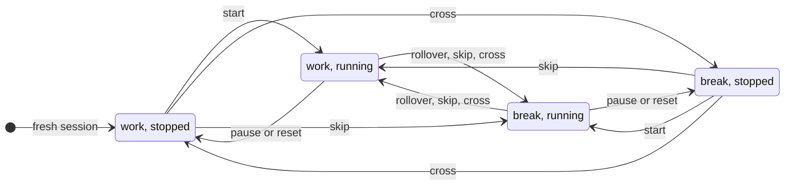
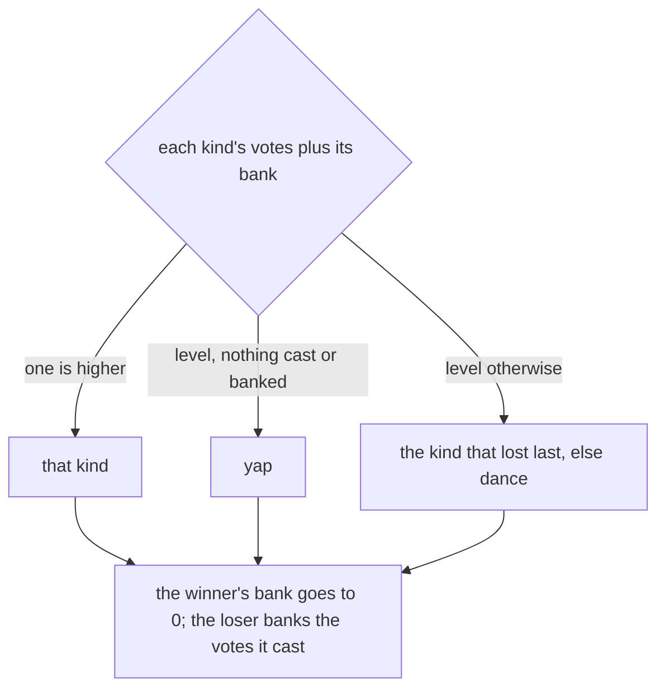
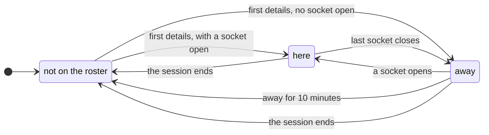
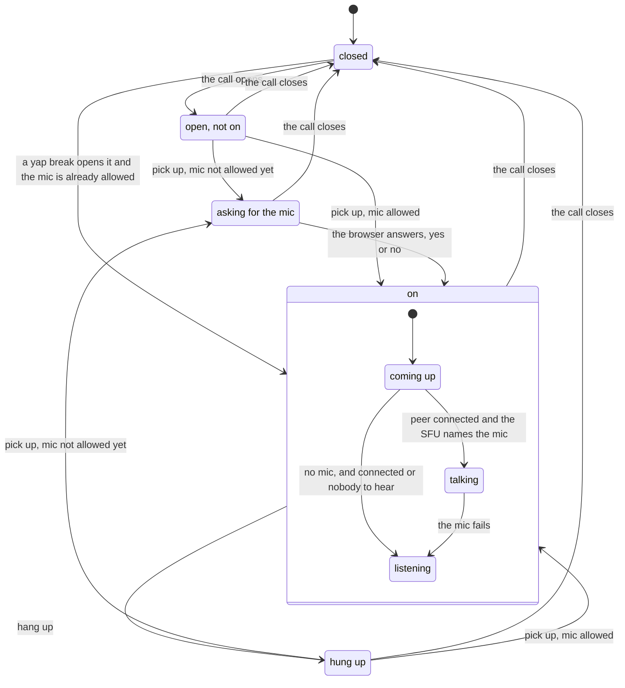
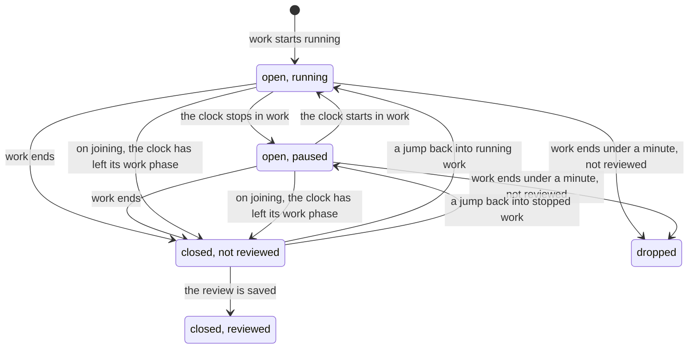
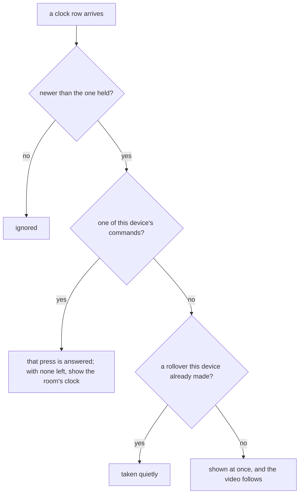

# State machines

Every piece of state in pomoduo that moves between named states, grouped by
the feature it belongs to. Some are written as one function; most are spread
across flags, rows and handlers. Each section says where the states live
today. For how the pieces fit together, see
[`architecture.md`](architecture.md).

The features each own one machine: the clock, the break vote, being in a
session, the call, and the pomo. Two more come from keeping devices in step
rather than from any feature. A few smaller ones sit in the page.

## The clock

`src/shared/clock.ts`, through `apply`. The room and every device run it.

The state is the phase (work or break) and whether the clock runs
(`endsAt` is set). The kind of the current break, the vote's tally, each
playlist's place, and whether the call is open ride along.

- A cross is a `nudge` or `stretch` past the end of the phase, or a `nudge`
  back past its start. It keeps the clock running or stopped as it was.
  `skip` always runs the next phase; `reset` always stops at the top of this
  one.
- `end` comes only from the room, after an empty session's grace, and sends
  any state to work, stopped, with nothing banked.
- Going forward into a break takes the vote and sets the break's kind. Going
  back into a break keeps the kind it had.
- The call opens on a yap break and closes on any other phase. Two
  exceptions: a fresh session starts with it open, and the first `start` of
  work closes it.
- `rollover` does nothing until the end time has passed, and chains from the
  exact end time.

## The break vote

`src/shared/vote.ts`, run inside `apply` when work ends.

Each member's pick is none, dance or yap. Picking the same kind again takes
the pick back. A pick stands from one pomo to the next.

The tally holds a bank for each kind and the kind that lost last. When work
ends with two or more members here:

A room of one gets a dance and leaves the tally as it was.

## Being in a session

`src/server/session.ts`. Two levels: each member, and the session as a whole.

A member is here while any of their devices has a socket open:

A socket alone does not put a member on the roster; their first `member`,
`vote` or `voice` request does. Only members who are here count in the vote.
Going away takes a member off the call.

The session is occupied while any socket is open. When the last one closes
the room notes the time (`emptySince`). If nobody is back within one work
phase plus one break, the room sends `end` and clears the roster.

One alarm serves both levels and the clock. It is set for the earliest of the
end of a running phase, the moment the member away longest comes off the
roster, and the end of an empty session's grace.

## The call

The call is the session's, and each member's place on it is their own.

Whether the call is open is the clock's `callOpen`, above.

A member's place on it lives in two halves. The device holds it as React
state in `src/client/session/call.tsx`; the room keeps a copy in the member's
row (`onCall`, `listening`, `muted`, `mic`), written through `POST .../voice`.

- On the device, being on the call is worked out each render:
  `callOpen && !hungUp && (answered || (mic allowed && phase is break))`.
  When the call opens or closes, every per-call flag resets.
- Hung up looks the same as open and not on. It differs in one way: it stops
  a break's call from joining on its own.
- After 10 seconds coming up, the device says its mic has not reached the
  other side.
- Mute is separate from all of these and carries from one call to the next.
  A muted mic keeps sending silence, so the SFU does not drop the track.
- The browser's answer about the mic (unknown, prompt, granted, denied) is
  separate too. A clean ask counts as granted, because some browsers never
  report it.
- The room clears a member's call columns when the call closes and when they
  go away.

## A pomo

`src/client/SessionPage.tsx` moves a pomo when the clock changes, whoever
changed it. `src/client/lib/ledger.ts` holds the steps. A pomo's state is its
`end` (empty while open), `runningSince`, and `confirmed`.

- Dismissing the review leaves the pomo not reviewed, with its note set from
  the intention.
- The edit dialog can put a pomo in any state by hand. An empty end reopens
  it, and only one pomo can be open at a time.
- `reset` and `end` during work pause the open pomo rather than close it.

The pomo is filed under a work day. A visit takes today's day unless a
late-night session on the saved day is still going. A pomo that opens across
4am within three hours of the last one asks which day it belongs to;
switching moves the open pomo too.

## Keeping devices in step

These come from running one clock across many devices, not from a feature.

**What a device shows.** `src/client/session/connection.ts`. The connection
is connecting until it has server time and the clock, members and track
lengths, then live. It has no state for a lost socket; party-db reconnects on
its own.

While any of the device's own presses is unanswered, it shows its own
prediction. A row from the room is handled like this:

A row from another member shows at once even while a press is unanswered.
The device also flips the phase on its own timer.

**Server time.** `src/client/lib/server-time.ts`. The offset starts as a
guess from the wall clock, is measured once on joining, and moves after that
only when a message shows it is more than 100 ms off.

## In the page

Smaller machines that belong to one device's page.

**The players.** `src/client/lib/player.ts`, called from
`src/client/SessionPage.tsx`. Each phase has one YouTube player, and the page
reads the player's own state changes. A change counts as
a click on the video only when it goes against what the page last told that
player, more than 800 ms after it told it.

| Player reports | Whose           | Only if                                                | Becomes                                                      |
| -------------- | --------------- | ------------------------------------------------------ | ------------------------------------------------------------ |
| playing, cued  | either          | always                                                 | the track's length is sent to the room                       |
| ended          | either          | always                                                 | the next track in that playlist                              |
| playing        | the other phase | not just told to play                                  | `skip` if the clock is stopped, else a dialog asks to switch |
| playing        | the current one | the clock is stopped, last told was not play           | `start`                                                      |
| paused         | the current one | the clock runs, it has played, last told was not pause | `pause`                                                      |

If a player told to play is not playing 1.5 seconds later, the browser has
blocked the sound, and the next click or key anywhere tries again.

**Joining.** Once the connection is live the page catches the ledger up,
once. If the visit came from the front page and the clock is stopped, it then
presses start, once.

**Dialogs.** Each dialog has its own flag: the name, settings, the review,
editing a pomo, switching phase, and the day question. More than one can be
open at a time.
